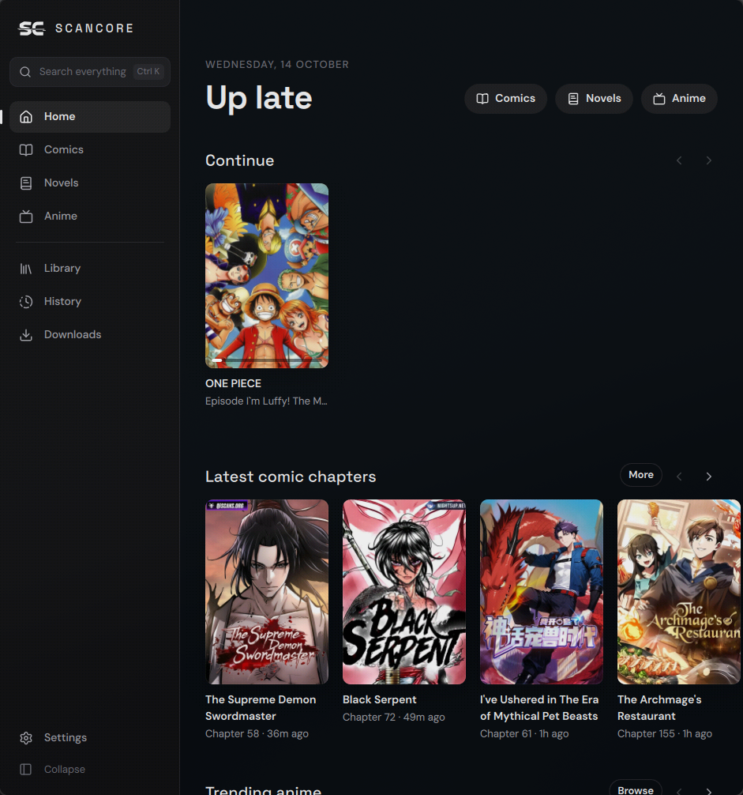
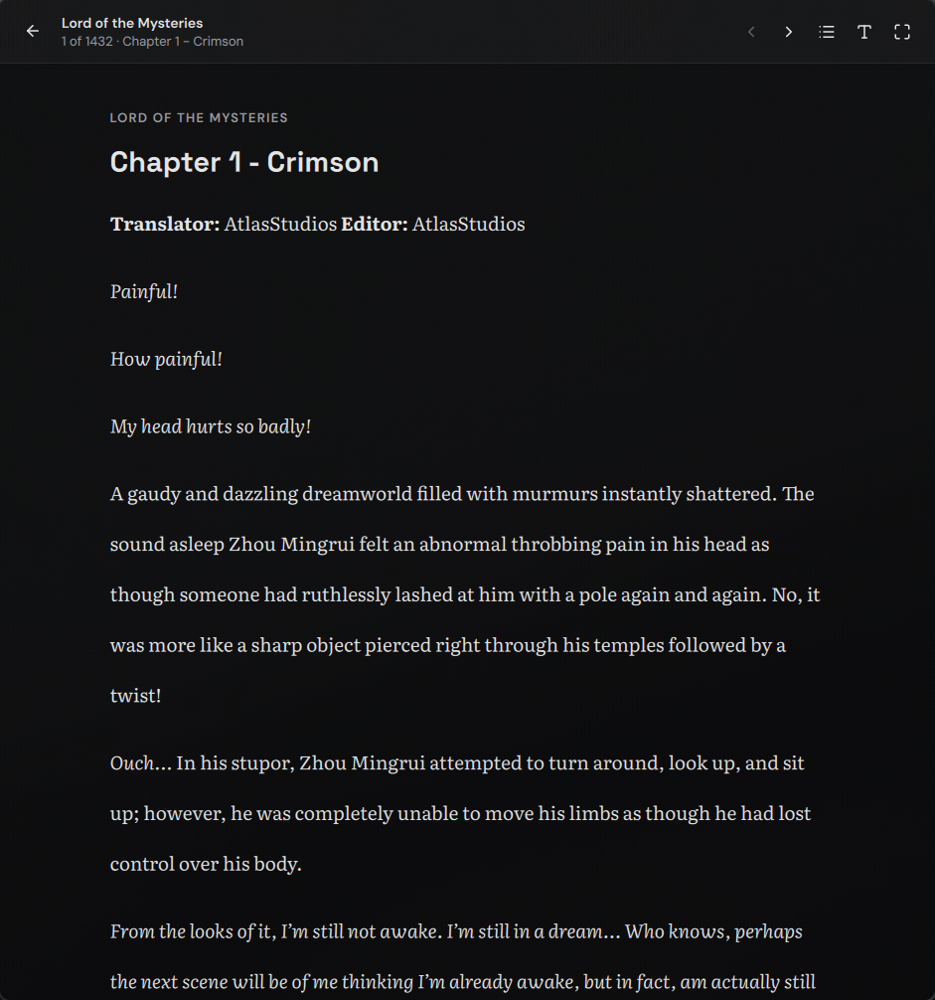
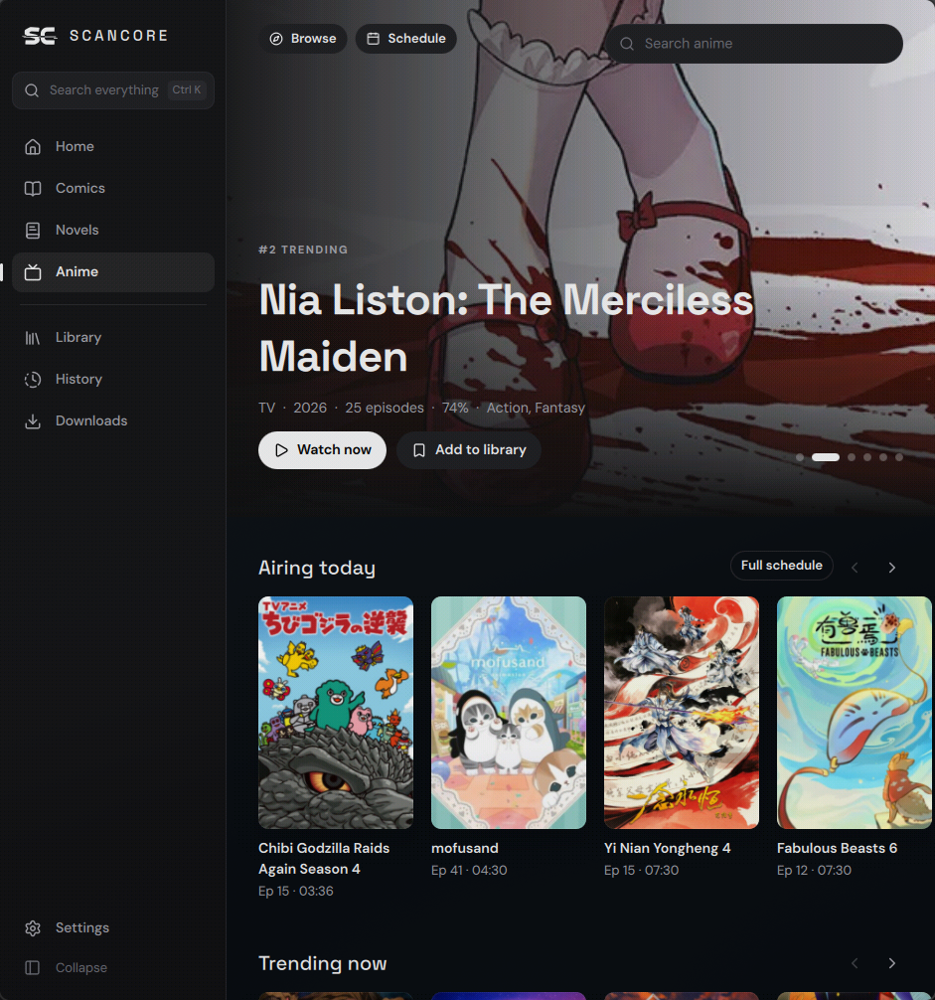

<p align="center">
  
</p>

<h1 align="center">SCANCORE</h1>

<p align="center">
  Read comics and novels and watch anime on your own computer or phone.<br>
  A native app in C++ and Qt Quick for Linux, Windows, macOS and Android, by <a href="https://mediumdev.com">Medium Dev</a>.
</p>

<p align="center">
  <a href="https://github.com/medium-gh/scancore/releases/latest">Download</a> ·
  <a href="#building">Build from source</a> ·
  <a href="sources/manifest.json">Sources</a>
</p>



## What it does

- **Comics.** Search Asura Scans, Webtoon, MangaDex, Flame Comics, HiveToons, Vortex Scans, Qi Manga, ThunderScans and MangaRead at once. Read in a vertical strip for webtoons or page by page for manga, with eased scrolling and adjustable width. Very tall strips stay sharp.
- **Novels.** Discover stories on Royal Road and search the NovelFull family of sites (NovelFull, AllNovelFull, ReadNovelFull, FreeWebNovel, LibRead and more). The reader has serif, sans and grotesk fonts, adjustable size, spacing and width, and paper, sepia, dark and black themes.
- **Anime.** Trending, seasonal, popular and top lists, search with filters and a weekly schedule, all from AniList. Episodes play in the app with resume, auto-next and AniSkip intro skipping.
- **Library and history.** Save series, keep your place in every chapter and episode, and get desktop notifications when saved comics or novels get new chapters.
- **Offline.** Download comic and novel chapters; downloaded chapters open without a connection.
- **Everything stays local.** No account and no server. Your library, history and settings live in one SQLite file you can back up and restore from Settings.
- **Optional scancore.onl account.** Sign in from Settings to bring your website library and comic reading history into the app; saves made in the app are sent back when the website knows the series.
- **More novel sites.** An optional pack (desktop only, about 400 MB) installs a private Python with lightnovel-crawler and adds about 130 more searchable novel sites.
- **Browser checks.** When a site asks for a browser check, open it in SCANCORE once to pass it; the app then reuses that clearance (desktop).
- **Android.** The same app with a phone layout: bottom tabs, stacked details pages and touch controls. Download the APK from the releases page.

| Novels | Anime |
| --- | --- |
|  |  |

## Keyboard

| | |
| --- | --- |
| `Ctrl+K` | Search everything / jump anywhere |
| `Ctrl+1`…`Ctrl+5` | Home, Comics, Novels, Anime, Library |
| `Ctrl+B` | Collapse the sidebar |
| `Alt+←` | Back |
| `F11` | Full screen |
| In readers | `↑` `↓` `Space` scroll · `←` `→` or `N` `P` chapters · `M` layout · `+` `−` size · `F` full screen · `Esc` close |

## Sources

Site addresses, availability and template options live in [`sources/manifest.json`](sources/manifest.json). The app ships with a copy and checks this repository for a newer one, so a site moving to a new domain, or breaking, can be fixed without a new release. The manifest holds data only, never code.

SCANCORE reads only what these sites show publicly. It does not bypass paywalls, logins or locked chapters. When a site asks for a browser check, it is marked unavailable rather than worked around.

To check every source against the live sites:

```sh
./build/debug/tests/scancore_probe comics "solo leveling"
./build/debug/tests/scancore_probe novels "lord of the mysteries"
```

## Building

You need CMake 3.25+, Ninja, a C++20 compiler and Qt 6.8 or newer with Qt Quick, Qt SVG, Qt WebEngine and Qt Image Formats. lexbor, the HTML parser, is fetched automatically.

```sh
cmake --preset debug
cmake --build --preset debug
ctest --preset debug
./build/debug/bin/scancore
```

On Arch Linux: `pacman -S qt6-base qt6-declarative qt6-svg qt6-webengine qt6-imageformats cmake ninja`.

Pushing a tag such as `v1.1.0` runs [the release workflow](.github/workflows/release.yml). It builds a Linux AppImage, a Windows installer and portable zip, a macOS universal disk image and a signed Android APK, then publishes them as a GitHub release.

### Android

Install Qt for Android (6.8 or newer, with Qt WebView and Qt Image Formats) and the Android NDK r27c, then:

```sh
~/Qt/<version>/android_arm64_v8a/bin/qt-cmake -S . -B build/android -G Ninja \
  -DQT_HOST_PATH=<desktop Qt prefix> -DANDROID_SDK_ROOT=$ANDROID_SDK_ROOT -DANDROID_NDK_ROOT=$ANDROID_NDK_ROOT
cmake --build build/android --target apk
``` macOS builds are not notarized, so on first launch right-click the app and choose Open.

## Layout

```
src/core           HTTP, HTML parsing, SQLite, image cache, background tasks
src/sources        comic and novel source adapters, manifest loading
src/app            services exposed to QML (Comics, Novels, Anime, Library, Downloads, App)
src/qml            interface: theme and motion tokens, components, pages
sources/           the source manifest
tests/             offline parser tests and the live source probe
packaging/         desktop entry, icons and the Windows installer script
```

## Licence

MIT. Fonts: DM Sans, Space Grotesk and Literata (SIL Open Font License). Icons: [Lucide](https://lucide.dev) (ISC). HTML parsing: [lexbor](https://github.com/lexbor/lexbor) (Apache 2.0).
